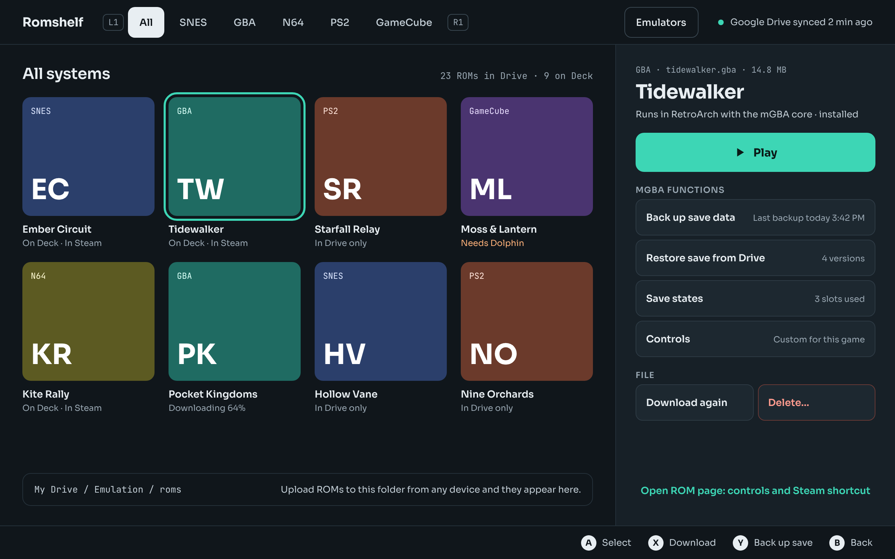
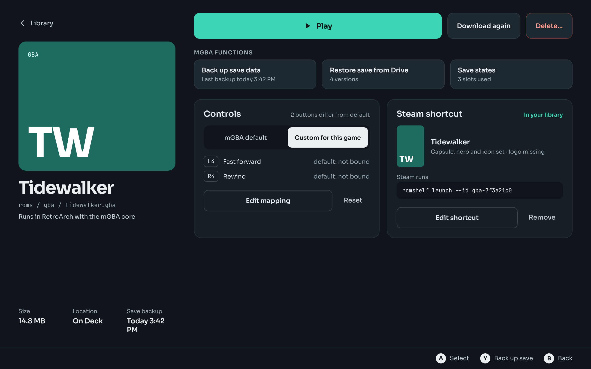
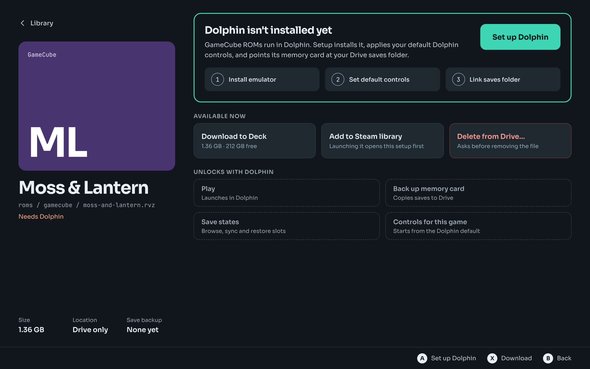
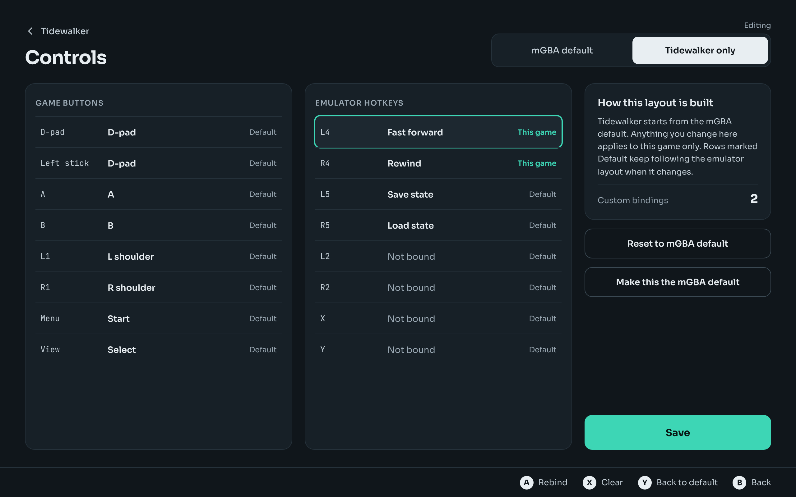
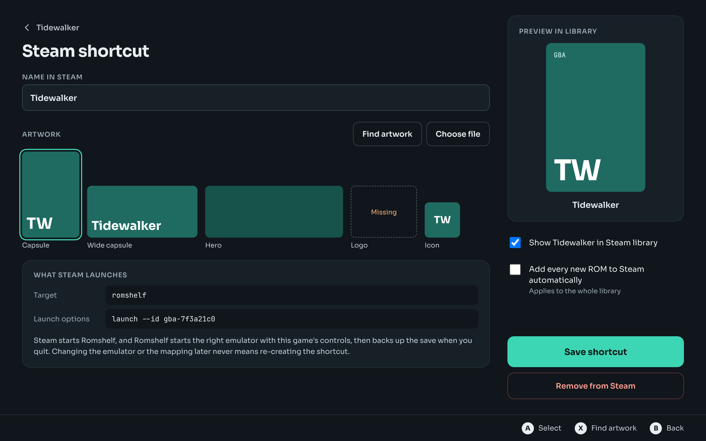

# Romshelf UI and UX guide

For Claude Code. This describes what every screen looks like and how it behaves. Five screens are drawn and approved; their screenshots are in `screens/` and their static markup is in `reference-html/`. Screens described in sections 6 to 8 are specified in words only and must be built from the same tokens and patterns.

When this guide and the reference HTML disagree on a value, the reference HTML wins. When a behaviour is not covered, choose what a console interface would do and note the choice in `PROGRESS.md`. Text in {braces} is a placeholder for a real value.

## 1. Principles

1. **Gamepad first.** Everything is reachable with D-pad, A and B. Touch also works. There is no hover.
2. **One screen, one job.** Library to browse, ROM page to act on a game, editors for controls and the Steam shortcut.
3. **Say what will happen.** Buttons name their action ("Download to Deck", "Set up Dolphin"). Status lines state facts ("Last backup today 3:42 PM").
4. **Never lose data silently.** Deleting and overwriting always ask, and say what is kept.
5. **Emulator differences are data.** The ROM page builds its action list from what the emulator adapter declares.

## 2. Design tokens

### Colour

| Token | Value | Use |
|---|---|---|
| `--bg` | `#10161B` | Screen background, input wells |
| `--surface` | `#172027` | Drawer, cards |
| `--raised` | `#1D2830` | Buttons and rows on a surface |
| `--border-subtle` | `#25313A` | Dividers, card borders |
| `--border` | `#2E3B45` | Button and row borders |
| `--border-strong` | `#3A4852` | Outlined buttons, key caps |
| `--text` | `#E8EEF2` | Primary text |
| `--text-secondary` | `#C3CED6` | Supporting text |
| `--text-muted` | `#9AA8B3` | Captions, labels, metadata |
| `--accent` | `#3DD6B5` | Primary action, focus ring, positive status |
| `--on-accent` | `#0B1A17` | Text on accent |
| `--warning` | `#FFB27A` | Needs attention ("Needs Dolphin", "Missing") |
| `--danger` | `#FF9C8F` | Destructive action text |
| `--danger-border` | `#6B3A36` | Destructive button border |

System colours for generated covers: SNES `#2B3F6B`, GBA `#1F6B62`, N64 `#5C5A22`, PS2 `#6B3A2B`, GameCube `#4A3470`. Text on them is white.

### Type

Sora for everything; JetBrains Mono for file paths, sizes, commands, counts and key caps. Bundle both; do not load from the network.

| Role | Size / weight |
|---|---|
| ROM title | 38 / 700, tracking −0.03em |
| Screen title | 30 / 700 |
| Drawer title | 28 / 700 |
| Section heading | 22 / 600 |
| Card heading | 18 / 600 |
| Primary button | 16 / 700 |
| Body, row label | 14 / 600 for labels, 400 to 500 for text |
| Supporting | 13 |
| Caption | 12 |
| Group label | 12 / 600, upper case, tracking 0.06em, muted |

Nothing smaller than 12 px.

### Shape and size

- Radii: key caps 6; rows and small buttons 10; buttons, tiles and action cards 12; cards and covers 16.
- Minimum target 44 px high. Standard row 50 to 52. Primary button 56.
- Screen padding 28 to 40. Gaps: 6 within a group, 12 between buttons, 16 to 22 between groups.
- Focus: 3 px accent outline offset 4 px on tiles; 2 px accent outline on rows and buttons.

## 3. Screen frame

Every screen is 1280×800 and has three bands:

- **Top band (64 px)** on the Library only: app name, system tabs with L1 and R1 key caps, Emulators button, sync status. Other screens use a back link (chevron and the parent's name) above the title instead.
- **Content.**
- **Footer hint bar (48 px):** right-aligned list of button glyphs and what they do for the focused element. Always present. It updates as focus moves.

## 4. Gamepad bindings

| Input | Everywhere | Library | Controls editor |
|---|---|---|---|
| D-pad, left stick | Move focus | | |
| A | Activate | Open ROM page | Rebind the row |
| B | Back, close dialog | | Hold one second to cancel a rebind |
| X | Primary shortcut for the screen | Download | Clear the row |
| Y | Secondary shortcut | Back up save | Return the row to default |
| L1 / R1 | | Previous / next system tab | Switch scope |
| Menu | Open Settings | | |
| View | Open transfers list | | |

Focus moves to the nearest focusable element in the pressed direction. Each screen remembers its last focus. After a dialog closes, focus returns to the element that opened it.

## 5. Approved screens

### 5.1 Library



- **Tabs:** All, then one per system that has a folder. L1 and R1 cycle. The selected tab is a filled light pill.
- **Grid:** four columns of tiles. A tile is a generated cover (system colour, system label top left in mono, initials of the title bottom left), the title, and a one-line status.
- **Tile status values:** "On Deck", "On Deck · In Steam", "In Drive only", "Downloading 64%", "Needs {emulator}" (warning colour), "Unrecognized file".
- **Header line:** the tab's name and, in mono, "{n} ROMs in Drive · {n} on Deck".
- **Drawer (right, 400 px):** always shows the focused tile's ROM. Metadata line in mono, title, the emulator line, Play, a group labelled "{emulator} functions" with one row per declared action (label left, current state right), a File group with Download (or "Download again") and Delete, and a link to the ROM page. If the ROM is not downloaded, the primary button reads "Download to Deck". If the emulator is missing, it reads "Set up {emulator}".
- **Folder strip:** bottom of the grid; the Drive path in mono and one sentence on how to add ROMs.
- **A** on a tile opens the ROM page. Right from the last column moves focus into the drawer.
- **Empty:** no ROMs yet → the folder path, the sentence, and a "Sync now" button, centred.

### 5.2 ROM page



- **Left column (340 px):** back link, large cover, title, Drive path in mono, emulator line, and three facts at the bottom: Size, Location, Save backup.
- **Action row:** Play fills the width; "Download again" and "Delete…" beside it. When not downloaded, the primary is "Download to Deck" and Play is absent.
- **Emulator functions:** a three-column grid of action cards (label, then state in muted text), built from the adapter's declared actions.
- **Controls card:** heading; a count ("2 buttons differ from default"); a two-option switch, "{emulator} default" or "Custom for this game"; the rows that differ, each with a key cap, the target, and what the default is; "Edit mapping" and "Reset".
- **Steam shortcut card:** heading and status ("In your library" in accent, or "Not in Steam"); capsule thumbnail, name and an artwork summary; "Steam runs" with the command in a mono well; "Edit shortcut" and "Remove". When not in Steam, the card shows one button, "Add to Steam library".
- Initial focus: the primary action.

### 5.3 ROM page, emulator missing



- Same left column, with "Needs {emulator}" in the warning colour.
- **Setup card** with an accent border: what is missing, one sentence on what setup does, the primary button "Set up {emulator}", and three numbered steps (Install emulator, Set default controls, Link saves folder). During setup the steps show progress and completion in place.
- **Available now:** Download to Deck, Add to Steam library, Delete from Drive…. Each has a one-line consequence beneath the label.
- **Unlocks with {emulator}:** the emulator-dependent actions as disabled cards with dashed borders. They are not focusable.
- When setup finishes the page becomes 5.2 without navigating.

### 5.4 Controls



- **Scope switch (top right):** "{emulator} default" or "{game} only". Opened from a ROM page it starts on the game; opened from the Emulators screen it starts on the default and the game option is absent.
- **Two lists:** Game buttons and Emulator hotkeys. Each row: the Deck input in mono, what it is bound to, and a tag: "Default" (muted) or "This game" (accent). Unbound rows read "Not bound" in muted text.
- **Rebind:** A on a row puts it in listening state ("Press a button…"); the next input becomes the binding. Holding B for one second cancels. If the input was bound elsewhere in the same list, ask whether to swap.
- **Side panel:** a plain explanation of inheritance, the count of custom bindings, "Reset to {emulator} default", "Make this the {emulator} default" (confirms, naming how many games will change), and Save.
- Leaving with unsaved changes asks: Save, Discard, or Keep editing.
- Editing the default scope hides the tags and the two side buttons.

### 5.5 Steam shortcut



- **Name in Steam:** text field, prefilled with the display name.
- **Artwork:** five slots: Capsule, Wide capsule, Hero, Logo, Icon. The focused slot has the accent ring. An empty slot is dashed and reads "Missing" in the warning colour. "Find artwork" searches the artwork service if a key is set in Settings and is otherwise hidden; "Choose file" opens a file browser. Every slot except Logo has a generated fallback, so only Logo can be missing.
- **What Steam launches:** Target and Launch options in mono wells, read-only, and two sentences explaining that Steam starts Romshelf and Romshelf starts the game.
- **Right column:** a library preview (capsule and name), "Show {name} in Steam library", "Add every new ROM to Steam automatically" with the note that it applies to the whole library, "Save shortcut", and "Remove from Steam".
- Saving a change that needs a restart raises the prompt in section 7.

## 6. Screens specified in words

Build these from the tokens and patterns above.

### First run

Four steps on one centred column, 560 px wide, one step visible at a time with a step count ("Step 2 of 4").

1. **Welcome:** one paragraph on what Romshelf does and that it ships no games. Button: "Connect Google Drive".
2. **Sign in:** "A browser will open for Google sign-in." Buttons: "Open browser", "Cancel". While waiting: "Waiting for sign-in…". If no browser can be opened, replace the body with numbered instructions for doing this step in Desktop Mode.
3. **Choose location:** a folder list starting at My Drive; A enters a folder, B goes up; the path so far in mono; button "Create Emulation folder here".
4. **Done:** the created tree in mono, the sentence on how to add ROMs, and "Open Library".

### Emulators

Back link to Library; title "Emulators". One row per emulator: name, the systems it runs, status ("Installed", "Not installed", "Update available", "Setup incomplete"), and a button ("Set up", "Repair", "Default controls"). "Default controls" opens 5.4 in default scope.

### Settings

Reached with Menu. Groups: Google account (address, "Sign out"), Drive folder (path, "Change location…"), Storage (ROM location, free space), Saves (versions to keep), Steam ("Add new ROMs automatically", artwork service key), About (version, "Check for updates", "Copy diagnostics").

### Transfers

A panel from the right listing downloads and queued backups, each with name, progress bar, rate and a cancel button. Empty state: "Nothing in progress."

## 7. Dialogs and transient states

Dialogs are centred, 520 px wide, on a dimmed background. Title, one or two sentences, buttons right-aligned with the safe choice focused first. B closes.

| Dialog | Title | Body | Buttons |
|---|---|---|---|
| Delete | "Delete {name}?" | Three choices as a list: "From this Deck (keeps it in Drive)", "From Drive (moves it to Drive's trash)", "From both". A checkbox, on by default: "Keep save backups". | Cancel, Delete |
| Restore save | "Restore a save" | List of versions: date and time, device name, size. | Cancel, Restore. Note beneath: "Your current save is backed up first." |
| Save conflict | "Two different saves" | "This Deck and Drive both have newer saves for {name}." Each side's date and device. | Use this Deck's, Use Drive's, Cancel |
| Restart Steam | "Restart Steam to apply" | "{n} shortcut changes are ready. They appear after Steam restarts." | Later, How to restart |
| Unsaved changes | "Save changes?" | | Save, Discard, Keep editing |
| Promote layout | "Make this the {emulator} default?" | "{n} games use the default and will change." | Cancel, Make default |

Progress and feedback:

- **Download:** the tile status shows a percentage; the ROM page primary button becomes a progress bar with percentage and a cancel affordance.
- **Toasts:** bottom centre above the hint bar, one line, four seconds: "Backed up Tidewalker", "Tidewalker added to Steam".
- **Errors:** inline where the action was taken, as one sentence on what happened and one action ("Couldn't reach Google Drive. Try again").
- **Offline:** the sync status reads "Offline" in the warning colour; Drive-only actions are disabled with the reason as their state line.

## 8. Launch window

Shown only when `romshelf launch` has to wait or ask. Full screen, background colour, content centred in a 560 px column: small cover, title, and one of:

- **Progress:** the step name ("Downloading", "Setting up Dolphin", "Checking save") with a bar. B cancels and exits.
- **Prompt:** the save-conflict or restore question from section 7.
- **Error:** what failed, "Try again", and "Open Romshelf".

When nothing needs waiting for, the window never appears and the emulator starts directly. After the emulator exits, a brief "Backing up save…" may show; it must not block returning to Steam for more than a few seconds, and continues in the background if it takes longer.

## 9. Wording

- Sentence case everywhere. Group labels are the only upper-case text.
- Buttons are verbs with their object: "Download to Deck", "Back up save data", "Remove from Steam".
- An ellipsis on a button means a dialog follows ("Delete…", "Change location…").
- Use the same words throughout: "Deck" for local, "Drive" for remote, "save backup", "save state", "shortcut", "set up" (verb), "setup" (noun).
- Times: "Today 3:42 PM", "Yesterday 9:10 PM", then "Oct 6".
- Never blame the user in an error. Say what happened and what to do.

## 10. Navigation map

```
First run ──► Library ◄──────────────────────────────┐
                │  A on tile                          │ B
                ▼                                     │
              ROM page ──► Controls (game scope) ─────┤
                │     └──► Steam shortcut ────────────┤
                │     └──► Setup (in place) ──────────┘
Library ──► Emulators ──► Controls (default scope)
Any screen ── Menu ──► Settings        Any screen ── View ──► Transfers
Steam ──► romshelf launch ──► (Launch window if needed) ──► emulator ──► Steam
```
